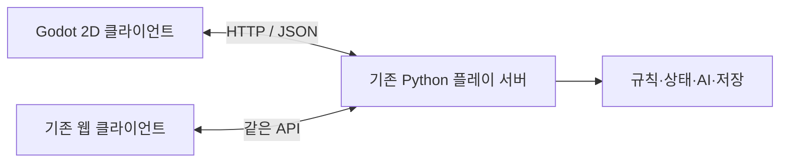

# Godot 플레이 클라이언트 구현 계획

상태: **기본/확장 플레이·설치 없는 Windows·메인 메뉴와 실행 중 멀티플레이 호스팅 구현** (2026-10-18).

사용자 결정: `godot-client` 브랜치(2026-10-21에 `docs/godot-client-plan`에서 이름을 바꿈)에서 시제품부터 구현한다. master에는 반영하지 않는다.
시제품 실행과 범위는 [실행 안내](godot-prototype-guide.md)를 따른다. 0단계의 실행·API 확인과
1단계의 실제 턴 진행에 이어 기본판 완주·드래프트·저장 복원, 세션/원격/다시보기와 확장 표시를
구현했다. 기존 네 기본판 시드와 전 옵션 두 시드를 완주했고, 같은 저장본의 웹/Godot 입력 대조를
이어 간다([기능 표](godot-feature-parity.md)). 사용자에게 이전 Windows 묶음의 시작/플레이 확인을
받았으며 카드/지도자 전수 조합, 새 Windows IME·그래픽/소리·LAN과 release export는 남았다. Python·uv가 없는 Windows를 위한
[내장 런타임 폴더 ZIP](godot-windows-package.md)을 준비했으며 사용자에게 개발 도구 설치를 요구하지 않는다.

사용자 요청: 보드·카드를 보고 조작하는 경험을 개선하기 위한 Godot 구현의 배포 용량·구현량과
단계별 계획을 정한다. Python 엔진은 유지한다. 이 문서는 착수 범위의 제안이며 전체 전환이나
일정의 확약은 아니다.

## 1. 제안하는 범위

2026-10-18 사용자 요청으로 시작 흐름을 메인 메뉴로 바꿨다. 싱글플레이·멀티플레이·설정·게임종료를
먼저 보여 주고 서버는 모드를 고른 뒤 실행한다. 멀티플레이 화면에서 LAN/Tailscale 주소를 골라
호스트 서버를 켜고 끄며 방 초대 링크를 복사하거나 입력한다. Python 실행기가 자신이 띄운 서버를
소유하며, Godot의 요청은 개인 임시 디렉터리의 원자적 요청/응답 파일로 처리한다. HTTP 서버에
서버 재시작·외부 프로그램 실행 기능을 추가하지 않는다. 관리자 키는 UI·argv·초대 링크에 넣지 않는다.
실행 및 검증 범위는 [실행 안내](godot-prototype-guide.md)와 [기능 표](godot-feature-parity.md)를 따른다.

- Godot의 **2D 화면과 GDScript**로 데스크톱 플레이 클라이언트를 추가한다.
- Python이 게임 상태·합법 행동·규칙·난수·AI·저장·좌석 권한을 계속 소유한다.
- 기존 웹 화면과 같은 서버에 연결한다. Godot과 브라우저가 같은 방에서 플레이할 수 있어야 한다.
- 첫 완주 대상은 **Uprising 4인 기본 게임, 사람 1명 + 앱 AI 3명**이다. 기본 게임의 책략·지도자와
  세부 효과 선택도 완주 범위에 포함한다. 확장은 이후 명시적으로 지원 범위를 넓힌다.
- 기본 배포에는 앱 AI를 넣고, 로컬 탐색 AI는 선택 설치로 분리한다. 기존 서버에 연결하는
  Godot 클라이언트는 그 서버가 제공하는 탐색 AI를 사용할 수 있다.
- ko/en 문구를 처음부터 분리하고 한국어로 우선 검토한다. 초기 개발은 테스트 가능한 한 OS에서,
  배포 검증은 macOS와 Windows에서 한다. 모바일·웹 export·3D 테이블은 후속 범위다.

프로젝트 목표와 기존 기능은 [README](../README.md), 현재 기준선은
[개발 인수인계](development-handoff.md), 기존 화면의 진행 상황은
[UI 개선 계획](ui-improvement-plan.md)을 따른다.

## 2. 배포 용량

아래 배포 용량은 **OS별 실제 export 전의 계획 추정**이며 설치 후 디스크 크기 기준이다.
압축 다운로드 크기는 아직 추정하지 않는다. MB는 약 100만 byte, MiB는 1,048,576 byte다.

| 배포 형태 | 초기 추정 | 구성 |
| --- | --- | --- |
| 원격 서버에 연결하는 Godot 클라이언트 | 40–120 MB + 이미지 캐시 | Godot release 실행 파일, 화면 코드·폰트·설정. 서버·모델은 호스트에 있음 |
| 로컬 기본판 | 200–450 MB | Godot + Python 실행 환경 + 서버 의존성 + 앱 AI + 현재 수준의 이미지 팩 |
| 로컬 탐색 AI 포함판 | 0.7–2 GB | 기본판 + CPU용 PyTorch 및 탐색 의존성 + 배포용 모델 1개 |

### 이 체크아웃에서 확인한 크기

2026-10-13, 원격과 일치하는 master `a6ea62dc` 및 에셋 저장소 `c4cf579`에서 파일 크기를 합산했다.
로컬 에셋의 집계에는 에셋 저장소의 기존 미추적 `board/map-ko.jpg`도 포함한다.
그 파일과 메인 저장소의 기존 미추적 `dune-ui-transfer-20261001/`는 이 작업의 변경 대상이 아니다.

| 대상 | 실제 파일 크기 합계 |
| --- | --- |
| `assets/cards/` | 119.04 MiB (1,439파일) |
| `assets/board/` | 27.39 MiB (3파일) |
| `assets/icons/` | 0.92 MiB (74파일) |
| `assets/tokens/` | 2.52 MiB (51파일) |
| 위 네 폴더 전체 | 약 149.87 MiB, 약 157 MB |
| Python 소스 `.py` 전체 | 6.34 MiB (254파일) |

이는 언어·그림 변형을 포함한 **현재 로컬 파일의 합계**다. 최소 배포 에셋이나 Godot에 import한
텍스처의 크기는 아니다. 언어·카드 manifest로 실제 필요한 파일을 고르고, 작은 미리보기와
큰 앞면을 나누며, Godot의 이미지 import 설정과 실행 중 메모리 사용을 함께 측정한다.
재현은 네 폴더의 파일에 `stat().st_size`를 합산한다. `du -shL`의 할당 크기와 구분한다.

현재 개발 `.venv`는 `du -sh` 기준 5.4 GiB이고, 그중 `torch`는 1.2 GiB,
`nvidia`는 3.2 GiB다. 이 개발 환경 전체를 배포에 복사하지 않는다. `pyproject.toml`의
UI extra는 FastAPI·Uvicorn이고, 탐색 AI의 의존성은 `cli/server.py`의
`resolve_search_checkpoint`가 별도로 확인한다. 플레이 배포에는 개발·학습 도구와 GPU용
CUDA 의존성을 포함하지 않는 환경을 따로 만든다. PyTorch는
[CPU용 설치](https://pytorch.org/get-started/locally/)를 제공한다.

이 기기의 참고용 옛 체크포인트 `champion-5081.pt`는 `du -h` 기준 225 MiB다.
현재 플레이 서버의 X 모델 크기는 이 체크아웃에서 확인하지 못했다. 체크포인트 형식은
옵티마이저 상태도 담을 수 있으므로 이 참고 파일을 배포 모델의 확정 크기로 사용하지 않는다.
선택 설치 단계에서 버전·구조 메타데이터를 유지한 플레이용 파일의 크기와 로더 호환성을 잰다.
모델을 줄이거나 교체하는 작업은 Godot 클라이언트 도입의 선행 조건으로 두지 않는다.

### 크기를 확정하는 방법

첫 단계에서 빈 Godot release export와 최소 Python 서버 묶음을 각각 만든다. 이어 동일한
이미지 팩을 붙여 OS별 실행 파일·리소스·서버·AI·ZIP 크기를 따로 기록한다. 릴리스에는
Godot 에디터와 전 플랫폼 export template 다운로드 묶음을 포함하지 않는다.

Python은 [PyInstaller의 onedir 배포](https://pyinstaller.org/en/stable/operating-mode.html)를
첫 후보로 삼되, Python 3.14·FastAPI·동적 AI import·리소스 경로를 먼저 검증한다.
OS별 Python 배포는 해당 OS에서 만든다. Godot의
[크기 최적화](https://docs.godotengine.org/en/stable/engine_details/development/compiling/optimizing_for_size.html)와
[이미지 import 설정](https://docs.godotengine.org/en/stable/tutorials/assets_pipeline/importing_images.html)은
실제 크기·가독성·메모리를 잰 뒤 적용한다. 초기부터 별도의 Godot 엔진 빌드를 유지하지 않는다.

그림은 기존 [로컬 이미지 정책](local-images.md)을 따른다. 앱과 이미지 팩을 분리하며,
이미지 파일의 추가·재배포는 `AGENTS.md`의 출처·사용 범위 확인 절차를 거친다.
위 용량 계산은 재배포 권한을 뜻하지 않는다. 이미지가 없어도 텍스트로 플레이할 수 있어야 한다.

## 3. 구현량과 추정 조건

현재 웹 화면은 JS 23파일·19,278줄, CSS 5파일·3,517줄, HTML 1파일·262줄로
합계 **23,057줄**이다. 라벨·번역·주석도 포함하며, 이 숫자를 Godot의 필수 코드량으로
환산하지 않는다. 기존 브라우저 E2E의 기능 범위는 인수인계 기준 62종이다.

서버 API 연결은 작은 부분이다. 구현량이 커지는 곳은 카드·지도자 효과별 선택,
단계별 조작, 숨은 정보 경계, 턴 확정·되돌리기, 확장 전용 화면, 재접속과 UI 검증이다.
GDScript에는 행동 선택과 표현을 옮기고, 규칙 판정은 Python의 합법 행동·관측을 사용한다.

| 도달점 | 누적 작업량의 초기 추정 |
| --- | --- |
| 보드·손패를 보고 카드→칸을 선택해 한 턴 실행하는 시제품 | 약 1주 |
| 기본 게임 완주·저장·되돌리기·기본 연출과 로컬 기본판 배포 | 약 4–7주 |
| 현재 확장과 원격·관전·다시보기까지 대응하는 첫 완성판 | 약 8–14주 |

숙련 개발자 1명이 주 5일 집중하고, 기존 규칙·AI를 변경하지 않으며, 2D 자산을 재사용하는
가정이다. 기능 검증·수정을 포함한 작업량 추정이지 Codex의 자동 실행 시간이나 납기 약속이 아니다.
Windows·macOS 실기 접근, 화면 피드백 횟수, 선택창 종류와 패키징 문제에 따라 늘어난다.
시제품에서 실제 작업량을 기록하고 남은 범위를 다시 추정한다. 병렬 에이전트 작업을 전제하지 않는다.

## 4. 연결 구조와 책임

Godot의 논리 모듈은 `ApiClient`(요청·인증·재시도), `ClientSession`(서버 상태·좌석·로그),
`ChoicePresenter`(합법 행동을 카드·칸·개수·대상 선택으로 표현), `BoardView`·`HandView`·
`MarketView`, `EffectQueue`(서버의 공개 기록을 순서대로 연출), `AssetCache`로 나눈다.
렌더러는 서버 상태를 직접 바꾸지 않는다. 로컬 선택 상태와 서버가 확정한 상태를 구분한다.

### 지금 재사용할 수 있는 API

| API | Godot에서 쓰는 목적 |
| --- | --- |
| `GET /whoami`, `GET /catalog` | 서버 기능, 두 언어 표시 데이터, 그림·보드 좌표 확인 |
| `POST /games`, 좌석 claim/release와 `GET /games/{id}/me` | 방 만들기·좌석 소유 확인 |
| `GET /games/{id}/snapshot?seat=N` | 같은 상태에서 읽은 summary·좌석 관측·합법 행동·로그 |
| `POST /games/{id}/actions` | `seat`, `revision`, `undo_count`, `index`로 제시된 행동 실행 |
| `POST /games/{id}/undo`, `POST /games/{id}/confirm` | 기존 되돌리기·턴 확정 흐름 |
| `GET /games/{id}/events` | SSE 변경 알림 및 현재 서버의 접속 상태 추적 |
| 기존 저장·불러오기·검토 API | 서버 형식의 저장, 관전·다시보기 |

`server/app.py`·`server/sessions.py`·`server/catalog.py`와
`static/session.js`·`static/turn.js`를 실제 계약의 기준으로 읽는다.

- 현재 인증은 쿠키 기반이다. 데스크톱 클라이언트는 Set-Cookie를 받아 서버·게임별로
  저장하고 해당 요청에만 보낸다. Godot의 요청 기능이 브라우저의 쿠키 동작을 자동으로
  대신한다고 가정하지 않는다. 관리자·좌석 토큰을 로그나 배포 파일에 넣지 않는다.
- HTTP 요청·JSON은 [Godot HTTPRequest](https://docs.godotengine.org/en/stable/tutorials/networking/http_request_class.html)로
  시작한다. 첫 로컬 시제품의 대기 갱신은 폴링으로 가능하다. 원격 단계에서는 HTTPClient로
  SSE를 읽는 어댑터를 연결하여 기존 접속 상태와 1초 이내 갱신 요구를 유지한다.
  SSE의 스트림 읽기·쿠키·재접속은 시제품 단계에서 먼저 검증한다. 막히면
  [WebSocket](https://docs.godotengine.org/en/stable/tutorials/networking/websocket.html) 어댑터의
  추가 범위와 일정부터 다시 정한다. 기존 서버에 WebSocket 경로가 있다고 가정하지 않는다.
- 늦은 응답이 새 상태를 덮지 않게 요청·revision을 관리하고, `undo_count`와 `log_epoch`도
  함께 처리한다. 같은 상태에서도 undo 뒤 행동 index가 달라질 수 있다.
- 서버의 좌석별 관측·로그에서 얻는 정보만 렌더링한다. 애니메이션이 새 정보를 공개하거나
  규칙 진행을 대신하지 않는다. 확정된 수치와 효과를 보여주고 뽑힐 카드 결과를 예측하지 않는다.
- 서버에서 아직 지원하지 않거나 클라이언트가 이해하지 못한 행동은 조용히 자동 선택하지 않는다.
  표시 데이터로 선택 가능한 일반 선택창을 제공하고 지원 범위의 누락으로 기록한다.
- 새로운 화면 정보가 필요하면 표시 API에 더한다. 규칙·codec·상태 이벤트를 화면 편의로
  바꾸지 않는다. 규칙 변경이 필요해지면 `docs/rules/` 출처를 확인하는 별도 작업으로 분리한다.

### 앱 실행과 종료

첫 배포의 실행 진입점은 기존 `launcher/supervisor.py`와 `command.py`의 서버 시작·준비 확인·
종료 관리를 재사용하는 방향으로 설계한다. 그 진입점이 Python 서버와 Godot 창을 띄운다.
현재의 포트 확인·표준입력 종료·Windows 프로세스 정리를 Godot에서 중복 구현하지 않는다.
frozen Python에서 `sys.executable -m ...`을 그대로 쓸 수 있는지는 첫 패키징 시험에서 확인한다.

로컬 모드는 앱이 소유한 서버를 저장·정리하고, 원격 참가자는 자신의 창을 닫아도 호스트 서버를
중지하지 않는다. 원격 호스트가 창을 닫을 때의 서버 유지·종료 선택은
[기존 런처 계획](server-launcher-plan.md)과 맞춘다. 쓰기 가능한 저장·로그·설정 경로와
읽기 전용 설치 경로를 구분한다.

## 5. 단계별 구현과 완료 조건

각 단계는 별도 작업 단위로 구현·검증·커밋한다. 추정 일수는 서로 더하는 작업일이며,
전체 일정의 상·하한은 3절의 불확실성을 포함한다.

| 단계 | 초기 작업일 | 결과와 완료 조건 |
| --- | --- | --- |
| 0. 실행·계약·용량 확인 | 1–2일 | Godot release와 Python 3.14 서버를 최소 묶음으로 실행. API·쿠키·리소스 경로·크기 목록을 기록. 현재 표시·선택 유형의 지원표 작성 |
| 1. 한 턴 시제품 | 3–5일 | 실제 서버에서 받은 보드·손패·좌석·합법 칸 표시. 카드→칸 선택, 행동 전송, 결과 갱신. 앱 AI 상대 한 턴 실행. SSE 연결 가능성 확인 |
| 2. 기본 게임 완주 | 8–12일 | 지도자 드래프트·책략·카드/지도자 효과 선택, 공개·구매·병력·스파이·전투·종료. 일반 선택창으로 기본 게임의 선택 유형을 모두 다룸. 저장·불러오기·확정·되돌리기 |
| 3. 플레이 경험 개선 | 3–5일 | 읽기 쉬운 보드 표시, 카드 비교, 선택 비용·효과 표시. 요원·카드·자원 이동, 차례·전투 결과. 빠르게/연출 줄이기. 창 크기·한글 입력·두 언어 확인 |
| 4. 원격·기본판 배포 | 4–7일 | 쿠키 유지·좌석 복귀·SSE 재접속·오래된 선택 거부·브라우저와 혼합 플레이. macOS/Windows에서 앱 실행→로컬 완주→종료 후 프로세스·포트 정리. Python/Godot 미설치 환경에서 실행 |
| 5. 확장 대응 | 12–20일 | CHOAM·프로모, Bloodlines·Tech, Immortality·Go to 11, Epic, Scouts 순서로 지원표·선택창·전용 판 추가. 각 묶음은 그 확장을 켠 완주·저장·재접속 확인 |
| 6. 기존 기능 대응·탐색 팩 | 5–9일 | 관전·다시보기·공개 정보/더미 조회·도움말·플레이 시계·개인 설정을 지원표로 대조. 선택 설치한 탐색 AI의 실제 실행·저장 복원·용량 검증. 누락 없이 지원 범위를 명시 |

2단계까지는 개발 환경에서 기본 게임을 끝까지 플레이한다. 2026-10-14에 4단계의 로컬 Windows
패키징 부분을 앞당겨 내장 Python + Godot + 개인 이미지 ZIP 후보를 만들었다. 실제 압축 크기
243.7 MiB·압축 해제 후 357.7 MiB이며, Windows 실행 검증과 원격 인증은 남았다.
4단계까지가 로컬 기본판과
원격 참가용 첫 배포, 6단계까지가 현재 기능 범위에 대응하는 첫 완성판이다.
확장을 지원하지 않는 초기 버전에서는 해당 게임 옵션을 생성·참가 화면에서 분명히 안내한다.

## 6. 검증과 계속할 기준

- Python 변경에는 해당 서버/런처 회귀와 pytest·Ruff·mypy를 적용한다. 표시 API 변경 시 기존 웹 E2E도
  확인한다. Godot 상태·선택 변환은 headless 테스트, 실제 조작·가독성·연출은 export한 창으로 검증한다.
- 같은 서버의 같은 국면에서 웹과 Godot의 관측·제시한 합법 행동·선택한 행동을 대조한다.
  새 클라이언트의 규칙 동작 근거를 기존 JS나 리뷰 해석에서 만들어 내지 않는다.
- 기본 게임과 각 확장의 선택 유형을 목록으로 만들고, 시나리오별 필수 선택창을 실행한다.
  일반 선택창이 있어야 할 결정을 빠뜨리지 않는지도 확인한다. 기본 게임 완주는 사람 1 + 앱 AI 3으로,
  원격은 Godot/브라우저 혼합 사람 좌석으로 확인한다.
- 비공개 정보, 확정 전 선택 변경, undo 뒤 stale index, 재접속, 로그 epoch 변경,
  배너·연출 중 입력, 서버 종료·복원은 기능별 회귀로 고정한다.
- 이미 있는 `saves/`의 호환성을 주장하려면 실제 저장본을 불러온다. 배포용 탐색 모델을
  새 파일로 배치하고 저장본이 참조하는 기존 모델을 덮어쓰지 않는다.
- 앱 용량·첫 실행 시간·이미지 로딩·최대 메모리·입력 반응·원격 갱신을 함께 기록한다.
  현재 환경에는 Godot export 실측이 없으므로 이번 문서의 숫자를 측정 결과로 표시하지 않는다.

한 턴 시제품에서 기존 웹보다 보드·카드 읽기와 선택 결과 확인이 편한지 직접 플레이로 평가한다.
가독성·조작감의 이득과 남은 선택창·패키징 작업량을 보고 이후 범위를 정한다.
첫 구현 단위 **0~1단계**에 이어 사용자가 **기본 게임 완주**를 다음 목표로 정했다.
시제품은 실제 서버에서 네 판을 종료까지 진행하고 드래프트·책략·구매·전투·최종 순위·저장 복원을
확인한다. 화면에서 실제 클릭과 선택 버튼 표시도 검증한다. Windows 실기 플레이,
전수 선택 유형 감사와 화면 개선은 남았다.
전체 전환은 시제품에 대한 사용자 피드백 뒤 범위를 정한다.

## 7. 남은 결정

착수 시 목표 OS의 우선순위와 실기 검증 환경, 기본 배포의 이미지 팩 범위, 탐색 AI의
선택 설치 여부를 확인한다. 본 검토의 기본 가정은 **PC 2D, 앱 AI 기본, 이미지 별도 팩,
현재 웹 유지, 로컬 기본 게임부터**다. 새 3D 모델 제작이나 게임 규칙·AI 교체는 포함하지 않는다.
